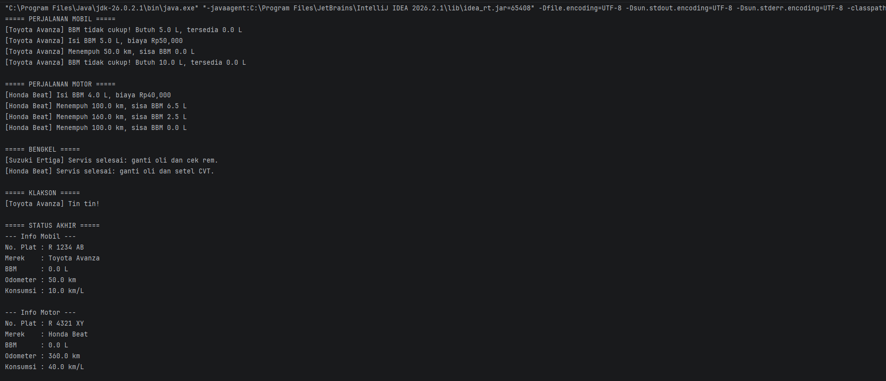

# Responsi Akhir Praktikum PBO — Sistem Otomotif

## Identitas Mahasiswa
| |                         |
|---|-------------------------|
| Nama | **DILAN FELIX HAPSORO** |
| NIM | **H1D025109**           |
| Tema  | **Otomotif**            |

## Deskripsi Singkat
Program CLI sederhana: mobil dan motor bisa diisi BBM, berjalan sejauh jarak tertentu
(selama BBM cukup), diservis di bengkel, dan mobil bisa membunyikan klakson.

## Struktur Class
| File | Peran |
|---|---|
| `Kendaraan.java` | Superclass abstract (atribut umum, `isiBBM`, `hitungBiaya`, abstract `jalan`) |
| `Mobil.java` | Subclass, implements `Servisable` dan `PunyaKlakson` |
| `Motor.java` | Subclass, implements `Servisable` |
| `Servisable.java` | Interface servis |
| `PunyaKlakson.java` | Interface klakson |
| `Main.java` | Alur pengujian program |

## Screenshot Luaran Program


## Cara Compile dan Run (Terminal)
```bash
javac *.java
java Main
```


